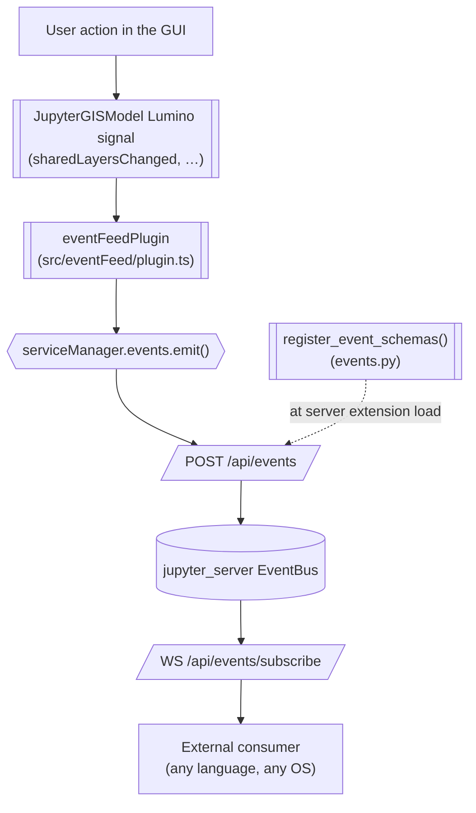

# Event feed

JupyterGIS can publish a stream of **GUI-originated events**, for example:

* A user opened a document
* A user added a layer
* A user lingered the viewport on a geographic area

Tools outside JupyterGIS can subscribe to these events.

This document explains why that stream exists, how consumers can use it, and what you (a
contributor) need to do when you add a feature that should emit an event.


## Using this prototype

### Clone the prototype

* Clone the repository:

  ```bash
  git clone git@github.com:geojupyter/prototype-jupytergis-eventfeed.git
  ```

* Change directory:

 ```
 cd prototype-jupytergis-eventfeed
 ```


### Start up the stack

* Follow the [](/contributor_guide/development_setup.md) instructions to create a Mamba
  environment and install JupyterGIS from source.
* Start JupyterLab **from the activated mamba environment**: `jupyter lab`.
* Get the token from the JupyterLab logs output from the previous step. E.g., from the
  following output, copy the `<my-token>` value.:

  ```text
      Or copy and paste one of these URLs:
        http://localhost:8888/lab?token=<my-token>
        http://127.0.0.1:8888/lab?token=<my-token>
  ```

* Start up the consumer **from an activated mamba environment in a separate terminal
  window**:

  ```bash
  export JUPYTER_TOKEN=<paste-my-token-here>
  uv run examples/event_feed_consumer/consumer.py
  ```

### Manual testing

In JupyterLab:

* Open a JGIS document, and observe that the consumer prints out the relevant event.
* Add a layer to the project, and observe that the consumer prints out the relevant event.
* Remove the layer from the project, and observe that the consumer prints out the relevant event.
* Change the layer symbology, and observe that the consumer prints out the relevant event.
* Move the viewport, wait 10 seconds, and observe that the consumer prints out the relevant event.
* Close the document, and observe that the consumer prints out the relevant event.


## Why emit events?

Often users cobble together many tools to perform their geospatial workflow.
When using many tools, it's difficult to track the flow of an analysis.
JupyterGIS events allow for monitoring of actions that were performed so users can
remember and repeat their GUI-based workflow.

This is driven by the [_GeoJupyter Trail_](https://github.com/geojupyter/trail)
project's design.


(which-events-matter)=

## Which events matter?

We deliberately chose not to emit events for programmatic changes using the Python API
because those are Notebook events, not JupyterGIS events.

GUI events that are important elements of the user's workflow or data exploration are
in scope for this system.
The implementation will be progressive, so if you're interested in an event that is not
currently emitted, please open an issue or PR :)


## Architecture

Events are emitted from the browser, because the GUI exists in the browser.



### Components

#### The event schemas

`python/jupytergis_core/jupytergis_core/event_schemas/*.yaml`

The event schemas define the interface between the emitter and consumers.
They are versioned JSON Schemas identified like: `https://schema.jupytergis.org/events/<object>/v<version>`.

#### The registrar

`python/jupytergis_core/jupytergis_core/events.py`

The registrar registers those schemas with the server's `EventLogger` when the
`jupytergis_core` server extension loads.
This enables the server to accept and validate browser emits.
The registrar globs the schema directory for `*.yaml` files, so adding an event type
only requires adding a schema file in the correct dir.

#### The emitter plugin

`python/jupytergis_core/src/eventFeed/plugin.ts`

The emitter plugin connects `JupyterGISModel` signals and the document tracker to
`app.serviceManager.events.emit()`, mapping signals to structured events.

#### The HTTP events API

`POST /api/events` and `GET /api/events/subscribe`

The events API is provided by
[`jupyter_server.services.events`](https://jupyter-server.readthedocs.io/en/stable/api/jupyter_server.services.events.html),
not by JupyterGIS.

* `POST /api/events` receives what `serviceManager.events.emit()` sends.
  It validates the payload against the schema registered under that `schema_id`, then
  passes the event to the server's event bus.
* `GET /api/events/subscribe` is a WebSocket feed.
  It rebroadcasts every event the server emits to every authenticated subscriber.

:::{important}
This API validates, but it will not tell users anything.
An unregistered `schema_id` or a `version` that doesn't match a registered schema comes
back as a `400` that only surfaces in the browser console (see
[Silent failures](#failures-are-silent)).

There is no server-side filtering by schema either, so consumers must filter by prefix
themselves (see [The event feed carries everything](#event-feed-has-everything)).
:::


Emitting from the browser onto this API is the pattern used by
[jupyterlab-telemetry](https://github.com/jupyterlab/jupyterlab-telemetry/blob/master/design.md).


## Anatomy of events

### ID

An event schema `$id` will always look like: `https://schema.jupytergis.org/events/<object>/v<version>`


### Subject

The thing performing the verb.
This is usually a user (client ID).


### Verb

The action being performed on the object.
For example, verbs in the "document" object might be "opened" and "closed".

Verbs should always be past tense ("added", not "add").


### Object

A JSON mapping describing the thing being acted upon by an event; the target of a verb.
For example a document path, a layer ID, and/or a source ID might be included in the
Object.

A `document_path` must always be present in an Object, but it can be `null` in the case
of ephemeral documents (e.g. ones created without a name via the Python API `GISDocument()`).

:::{important}
A document path is not a unique identifier for a document.
"Save as..." can change the document's path in the middle of an event stream.
We're ignoring this problem right now.
:::


### Order of fields

For human readability, always pass Subject first, then Verb, then Object.
As in English: "Sally presented the lecture."
Subject: Sally; Verb: Presented; Object: Lecture.


## Adding a new event

When you add a feature that should be visible to event consumers:

1. **Decide whether it is a new object or a new verb.**
   Adding a `verb` value to an existing schema is additive; changing or removing a
   field is not. See [Evolving a schema](#evolving-a-schema).
2. **Write or extend the YAML schema** in `event_schemas/`.
   Registration is automatic, so there is no wiring step.
3. **Add a case to `EVENT_SCHEMA_CASES`** in
   `python/jupytergis_core/jupytergis_core/tests/test_events.py`.
   A test asserts that every schema file on disk has a case, so a new schema without
   one fails the suite by design.
   The `$id` without coverage will be reported in the test results.
4. **Listen to the signal** in the emitter plugin and emit the event.
5. **Verify end to end** by watching the reference consumer
   (`examples/event_feed_consumer/consumer.py`) while you perform the action in the
   GUI.
   This step is important: see [Failures are silent](#failures-are-silent).


## Pitfalls

(failures-are-silent)=

### Silent failures

An event can fail to be delivered without any obvious error.
Depending on where the event was emitted from, the behavior is different:

- From the browser via the HTTP events API (`POST /api/events`): an unregistered
  `schema_id`, or a `version` that doesn't match the registered schema, is rejected by
  the server with a `400`.
  The promise returned by `emit()` rejects, and the emitter plugin logs it to the
  browser console.
  The UI doesn't communicate this failure.
- From Python (`EventLogger.emit()` directly, as in our tests): an unregistered
  `schema_id` only warns (`SchemaNotRegistered`) and returns `None`.
  `emit()` also returns early when the logger has no handlers at all.
  It does not `raise`!

"I didn't see an error" is not evidence that an event was delivered successfully.
Our tests check the event stream for expected content, and when testing manually you
should do this too.


### `version` must be a quoted string

`jupyter_events` requires the `version` to be a string, e.g. `version: '1'`.

A YAML parser will implicitly parse `version: 1` as an integer.
You must quote it to parse it as a string.

:::{admonition} Aside
[YAML is a complex format with many pitfalls](https://ruuda.nl/2023/the-yaml-document-from-hell).
Consider defensively quoting all strings so they are explicitly known to be strings.
:::


(event-feed-has-everything)=

### The event feed carries everything

`/api/events/subscribe` rebroadcasts *every* event the server emits, including
`jupyter_server`'s own.
Consumers filter client-side on the `https://schema.jupytergis.org/` prefix.
Per-schema subscription endpoints are only a partially implemented server feature;
prefix filtering is the reliable approach.


### High-frequency events need throttling

We haven't yet implemented viewport pan/zoom or pointer move events.
These events fire rapidly and would be unreasonable to record them all.

When we implement high frequency events we need to think about the proper way to
throttle them.
For viewport pan/zoom, we should start out with only firing these events after the
animation has settled for a fixed period of time (i.e. the viewport is "lingering").


(evolving-a-schema)=

### Evolving a schema

The `$id` carries the version, so a breaking change means a new file and a new `$id`
(e.g. `.../layer/v2`, as opposed to an edit to the `v1` schema).

Consumers filter by prefix, so both versions can technically be published side by side
while consumers migrate.

Additive changes like a new optional property or a new `verb` value can go into the
existing version without releasing a new one.


## Consuming the feed

Useful when you are debugging the pipeline or writing a consumer:

- **Endpoint:** `ws://<host>:<port>/api/events/subscribe`
- **Auth:** the Jupyter token, as `?token=<TOKEN>` or an
  `Authorization: token <TOKEN>` header.
- **Payload:** one JSON object per event, carrying at least `schema_id` and
  the event's own fields.

Use the **reference consumer:** `examples/event_feed_consumer/` for manual testing.

An event might look like this (not an actual event, just an example):

```json
{
  "schema_id": "https://schema.jupytergis.org/events/document/v1",
  "subject": "42",
  "verb": "opened",
  "object": {
    "document_path": "examples/france_hiking.jGIS"
  },
}
```

:::{note}
A timestamp isn't included on this event.
A request was opened to allow opt-in to subscribing to events with metadata here:
<https://github.com/jupyter-server/jupyter_server/issues/1710>
:::


## Alternatives considered

We considered the following alternatives for clients to monitor events emitted by
JupyterGIS:

1. Join the collaboration room as another Yjs client (`pycrdt-websocket`):
   Powerful, but the consumer has to speak the Yjs sync protocol and reverse-engineer
   raw CRDT deltas to work out that "a layer was added".
2. Watch the document server-side: The server sees merged CRDT state, so it cannot
   tell a GUI edit from a notebook `GISDocument.add_layer(...)` call without extra
   bookkeeping. See [Which events matter?](#which-events-matter).
3. **Subscribe to an event feed**: Emit custom events following a well-known schema
   using [`jupyter_events`](https://github.com/jupyter/jupyter_events).

We chose the third option!


## Further reading

- [Jupyter Events](https://jupyter-events.readthedocs.io/en/latest/) and its
  [application guide](https://jupyter-events.readthedocs.io/en/latest/user_guide/application.html)
- [`jupyter_server.services.events`](https://jupyter-server.readthedocs.io/en/stable/api/jupyter_server.services.events.html):
  the `/api/events` handler and the `/api/events/subscribe` WebSocket endpoint
- [`EventManager`](https://jupyterlab.readthedocs.io/en/latest/api/classes/services.EventManager-1.html):
  the JavaScript client used by the emitter plugin
